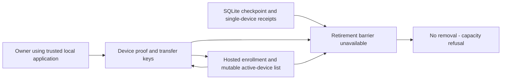
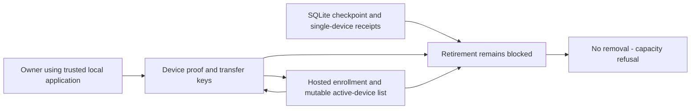
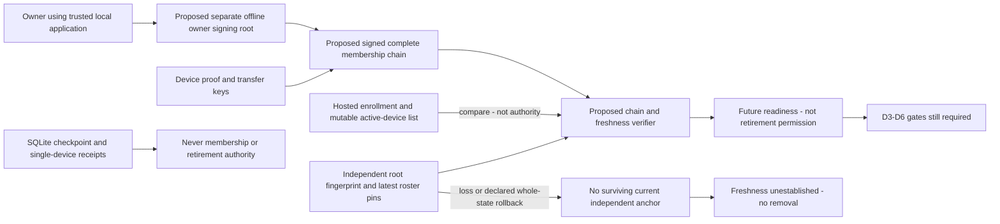

# Security Hardening Proposal: D2 owner authority and roster trust

## Decision

This is a design-only D2 specification at source base `91973f57d9d4f9033dcf3455299046784ddf9742`. The founder selected the separate offline owner-signing artifact design direction for independent review. No actual owner root has been created or deployed. We have not added schema, changed enrollment, generated a recovery artifact or authorized retirement. The five founder policies are unchanged. Root custody is a new mechanism decision; the founder explicitly selected the direction, not a serialized construction or implementation.

We have received the independent design review of packet `0bf2e4ae04b0445be751002bb6bc33aed4f19d95` and are proposing semantic corrections, not recording technical acceptance. The report is supplemental AI evidence, not certification. The new fork-adjudication proposal below requires independent review and subsequent explicit acceptance; approval to correct documents is not acceptance of that mechanism. Direction selection is recorded in [the founder decision](../founder-decision.md). D6 and D7 remain blocked; the existing no-removal baseline remains operational.

## Executive Recommendation

We compare **Option 1: keep retirement blocked with existing device identity**, and **Option 2: separately held offline owner authority with independently pinned membership history**. Option numbers here refer only to the D2 root choice, not to the earlier hot-ring/vault options.

I recommend Option 2 as a candidate for design review, with that customer-held artifact direction now explicitly selected. Independent assessment of its recovery and update burden remains required. We would use the existing mature signature family in a separately reviewed domain; no new cryptographic construction or wire format is assigned in this packet. If customers cannot safely keep and update the independent anchor, Option 1 is the safer outcome. We must not turn email recovery or the first computer's self-assertion into owner authority by convenience.

## Evidence

I inspected the native enrollment/store boundary, approved-device signature context, existing receipt schemas and hosted initial/approved enrollment functions. The important source distinction is that possession and authenticated enrollment are present, but those do not establish provider-independent roster completeness or freshness.

| Evidence | Source or supplied review | What it establishes |
| --- | --- | --- |
| Device possession | `src-tauri/src/sync_v2_device_enrollment.rs`, StoredDeviceIdentity, enroll_initial_device_with_store | OS-random Ed25519 seed in Windows Credential Manager; initial possession bound to an Auth session. The Active native state is not an owner root. |
| Approved transfer | `src-tauri/src/sync_v2_approved_device_transfer.rs`, target_proof_message, source_approval_message | Target possession and source approval bind identities, sessions, challenge and one workspace-key transfer. No complete owner-root roster chain is carried. |
| Hosted enrollment | C10-03b complete_initial_device_enrollment and C10-03e complete_approved_device_enrollment under `proofs/sync-v2-identity/supabase/migrations/` | Owner-scoped current device checks; approved enrollment enforces the two-device cap at C10-03e lines 269 and 508 and requires an active source. C10-03b refuses initial enrollment when an existing device needs approval and rate-limits attempts; it does not itself contain a numeric two-device cap. No D2 root or roster pin is provided by these functions. |
| Local receipt shape | `src-tauri/migrations/0011_sync_v2_checkpoint_anchors.sql`, 0012 and 0014 | Anchor/receipt data are in SQLite; acknowledgements and applied receipts have workspace-only primary keys, not an all-device membership barrier. |
| MP-2 root and rollback | Supplied Claude preservation-first design review, 2026-10-11 | First-device circularity and all-device pre-revocation restore need explicit trust decisions and recovery behavior; not an executed protocol proof. |
| D2 independent design review | Conversation-supplied Claude report dated 2026-10-11 at packet `0bf2e4ae04b0445be751002bb6bc33aed4f19d95` | DG-1 freshness/replay, DG-2 membership mismatch, DG-3/4 forks and custody, DG-5 epoch bounds, SF-1 inventory, DG-6 diagram and PD-1 disclosure; analytical counterexamples, not executed protocol tests. |
| Founder constraints | [Existing preservation-first packet](../prior-context.md) | Every active device participates, old material is preserved, consent is explicit, membership is owner-approved and not a provider-only list. |

[Context](../context.md) pins ten LF/Git-blob hashes and identifies review limits. Proposed behavior below is not a claim about the current implementation. [RFC 8032](https://www.rfc-editor.org/rfc/rfc8032.html) describes the signature family already used by device code; this does not certify our proposed membership protocol. The need for independently retained freshness anchors is our protocol inference, not a property supplied by the signature algorithm.

## Current Design And Failure Mode

We already ask a device to prove possession of its own seed and bind a new device's transfer context to authenticated sessions. That is a useful enrollment boundary. It says nothing about whether the provider returned every legitimate device or whether its list is the latest. A valid signed old list is still old.

If we promote the first device's key to owner root, we close the diagram's gap by changing the trust model, not by proving owner independence. A compromised first device could sign a membership history omitting a computer whose acknowledgement retirement needs. Provider-only list checks cannot repair that omission. We therefore do not recommend this as a conforming retirement mechanism. It remains a stated residual of the existing enrollment proof while removal is unavailable.

SQLite checkpoint anchors are useful against a subset of replay attacks, but a complete database restore can roll them back together with receipts. Moving a roster pin outside SQLite helps with ordinary database restore only. It does not make protected storage immune to loss or whole-machine rollback. If all pins and the independently held latest anchor are lost or rewound, an authentic old chain is indistinguishable from current state. We must state that limit instead of labelling it cryptographically solved.

## Desired Invariants

We would require the following falsifiable properties before D2 can feed any future barrier:

- Root public identity is bound to one opaque owner identity and root generation, explicitly approved outside the hosted roster; neither Auth email recovery nor device possession substitutes.
- Device proof keys, transfer keys, owner signing keys and record-encryption keys have separate purposes. Owner signing cannot decrypt records or authorize new record writes.
- Every accepted membership transition is purpose/scope bound, owner-root authorized, exact-parent chained and strictly ordered. Missing predecessors, duplicate identities or conflicting same-position records refuse.
- Offline age never removes a device. Revocation is a separate explicit owner action, with fresh device identity/key required for later re-enrollment.
- A lower epoch never replaces an independent pin; an equal epoch with a different digest is a fork, not a tie to resolve using server preference.
- Restoring SQLite never lowers independent root/roster or hosted write-floor pins. Missing, disagreeing or wholly lost anchors prevent retirement readiness.
- A complete current signed roster plus exact device possession is necessary, not sufficient, for retirement. A roster-applied acknowledgement is not a preparation, and preparation is not D6 mutation consent.

## Constraints And Non-Goals

We stay single-user and local-first. The root is for one person's computers, not organizations, roles, seats or collaboration. No paid resource is created. The current hosted two-device limit is preserved; a new application-level roster cannot secretly expand it.

No D2 schema or production parser is implemented. D3 owns preservation formats and Windows budget measurement. D4 owns owner/workspace epoch fencing and hosted lock changes. D5 owns multi-store ordering. D6 owns real consent and mutation. We assign semantic requirements, not serialized magic bytes, KDF parameters, a root recovery code, or a minimum client version.

Same-user compromise and a malicious bootstrap application can observe a root loaded into that application. “Offline” describes custody between uses, not a hardware-security guarantee. Root secrecy and user ceremony are residual risks requiring review. A physical possession check must not be sold as proof that a compromised screen showed the correct device.

## Before Architecture

The current list can support enrollment, but it cannot produce retirement permission. The diagram shows this missing authority rather than inventing an existing barrier.

## Options

### Option 1: Keep retirement blocked with existing device identity

We retain the established possession and transfer proof and do not add an owner artifact. This is a real terminal design choice: it asks customers to manage fewer secrets and avoids a new trust root, catalog, signing ceremony and restore reconciliation path. The cost is continued capacity refusal when the bounded ring fills. We must disclose that cost rather than silently discard keys or enlarge the ring.

No new trust state needs migration. If future proof work fails, staying here preserves historical access and ordinary local editing. Device and provider compromise risks in the existing dormant proof are not transformed into destruction authority because no retirement function is supplied. The baseline does not solve complete-roster trust; it contains the consequence by keeping retirement blocked.

| Change | Before | After | Security consequence | Cost |
| --- | --- | --- | --- | --- |
| Retirement decision | Unavailable barrier | Explicit blocked outcome | No incomplete roster authorizes removal | Rotation availability remains bounded |
| Recovery obligation | Existing device/recovery artifacts | Unchanged | No additional owner-signing loss mode | No capacity reclamation |

### Option 2: Separately held offline owner authority with independently pinned membership history

We would create an owner signing identity independent of all device keys. The owner would keep its private material in a separately reviewed customer-held artifact, not in the hosted service, repository, ordinary SQLite backup, or automatic always-loaded device store. The root's public fingerprint and owner binding would be pinned in independent local state and the customer-held anchor. Those pins are public authority metadata, not project content.

The first-device circularity is resolved by a separate bootstrap ceremony under an explicitly trusted application: create the root independently, review and pin its public identity, prove device 1 possesses its distinct keys, then root-authorize the first membership record. Device 1 is a member, not the authority that defines the root. Auth establishes the hosted subject to which the owner binds the root; it cannot later replace that pinned root. An email password reset must not silently mint a replacement. An existing enrolled computer is not grandfathered into this chain without an explicit root authorization and proof.

A separate artifact is operationally expensive. We would need it for membership-changing actions and root succession, not daily local editing, record decryption or ordinary Sync pulls. Loading it on a compromised endpoint may expose it; keeping it offline between actions narrows exposure but does not eliminate that risk. A passphrase-derived root would trade another artifact for guessing risk and a new parameter/recovery burden, so it is deferred rather than silently chosen. A hardware/offline signer could improve custody later, but would add equipment/workflow obligations not authorized here.

#### Semantic membership record and lifecycle

A future reviewed canonical encoding must cover purpose/version, owner ID, root generation/fingerprint, epoch in the proposed semantic range 1..=18,446,744,073,709,551,615 (u64 maximum), exact parent digest, unique event nonce, operation, affected device ID, exact proof/transfer public keys, complete resulting active set and permanent revocation set, client capabilities, and root signature. The verifier recomputes state from the complete chain and compares it with the signed resulting set. A provider-supplied snapshot alone is not completeness evidence. Neither wall-clock timestamps nor a signature expiry establishes freshness.

The owner-wide roster is the conservative starting point because current hosted membership is owner-scoped. Every active owner device is included in every workspace retirement barrier; a device without the required workspace preservation capability blocks readiness rather than being omitted. Introducing narrower workspace membership/grants would require its own complete owner-approved grant history and review. We do not introduce that exclusion path here. Each future workspace barrier additionally binds its workspace, event, roster tip and floor, preserving single-user scope and the two-device limit.

The signed operations are conceptual Bootstrap, Enroll, Revoke, CancelUncommittedIntent and RootSuccessor. A proposed exceptional ForkResolution has distinct multi-parent semantics described below; ordinary transitions remain single-parent. Enrollment needs target proof of possession, authenticated owner/session checks, owner-root approval and current epoch verification; existing source approval and key-transfer controls remain necessary. Revocation invalidates all affected workspace preparations and prevents the removed key's future membership use without erasing local data. It does not imply rotation can retract exfiltrated keys. An exact replay returns the same no-new-effect result; the same nonce with different bytes refuses. Cancelled intent must not rewind or reuse an issued epoch. We reserve one epoch for each distinct issued transition or cancellation record; exact retries of identical canonical intent/publication bytes consume none. A cancellation binds the original intent nonce/digest, voids it permanently, and advances once from the highest established issued position. It cannot cancel a committed effect, change the payload of an existing nonce or infer cancellation from a lost response. D4/D5 must prove the reservation, cancellation and publication reconciliation journal before an API exists. A blocked/unissued request consumes no epoch.

The u64 range is a semantic proposal, not an encoding choice or a measured usage budget. Membership ceremonies are expected to be infrequent; even a hypothetical one million newly issued events per day would require more than fifty billion years to exhaust that range. This arithmetic is not a performance result, rate allowance or protection from storage exhaustion. Independent byte/event resource budgets remain required and may refuse much earlier without truncating history. At the last representable epoch, new issuance fails closed as EpochExhausted with no counter wrap, root-generation reset or lower pin. Exact committed retries remain no-new-effect reads. We propose no epoch-space successor shortcut; a successor would need its own review. To test exhaustion we would use a reduced-bound fictional model and boundary fixtures, not generate 2^64 records.

D4/D5 must define authoritative publication and intent reconciliation; signing a record alone does not prove all stores applied it.

Root succession requires old-root authorization, new-root possession and a current independently pinned chain tip. Loss of the old root is not an automatic succession event. If no trusted authorized succession path survives, freeze membership changes and retirement; preserve local work and captured-data recovery. A fresh account/workspace migration, if ever desired, is a separate explicitly consented operation, not recovery of the old trust identity.

#### Pinning, restore and freshness

The conceptual independent pin binds owner, root generation/fingerprint, latest acknowledged epoch and exact digest, plus outstanding signed intent metadata. It is separate from SQLite and cannot be repopulated solely from an ordinary database backup. The customer-held latest anchor also binds these values. Bare possession of an old root private key proves signing authority, not the latest history.

On ordinary database restore, the higher independently retained pin wins only as a lower bound: fetch and verify the chain continuing it, then reconcile the restored database. Never accept lower epochs, reset the pin to the backup, delete keys or declare a revoked member active. Equal-epoch different-digest pins indicate a fork; stop authority-bearing operations and preserve both pieces of evidence. A higher tip from another legitimately anchored device is adopted only after chain verification and reconciliation, not numeric max alone.

If every computer is restored from a pre-revocation database while independent pins survive, the regression is detectable. If every independent pin is lost, there is no automatic first-enrollment fallback. Recovery may use a separately retained current customer-held anchor or a surviving trusted device with a consistent chain, subject to reviewed proof. If neither survives, state is **FreshnessUnestablished**. A current-looking provider response, email confirmation, older recovery file or old root key cannot clear it.

Even multiple copies can all be old. D2 cannot prove latest state against a provider that hides newer history after every independent anchor has rolled back. We therefore block retirement in a declared total-anchor-loss/whole-state-restore flow. Undetected total environmental rollback remains a residual, not a solved property. The future UX must not give an owner an “accept old roster” shortcut that grants pruning authority.

Durable signing history reduces accidental parent/epoch reuse within one artifact instance. An offline duplicate cannot know that another copy has advanced; we cannot promise prevention of stale-copy signing. Custody guidance must distinguish an inactive protected backup from a second working signer: do not use both copies independently, and reconcile an old backup against surviving current pins before authorizing anything. Exact backup/activation protection belongs to D3. Copy discipline reduces accidents, not theft or compromised-screen risk. Fork detection still requires honest pins or compared evidence.

#### Proposed fork adjudication, not an accepted recovery mechanism

A fork always freezes authority-bearing operations first. We retain all discovered branches, pins and keys; neither server preference, numeric maximum, email reset nor choosing a USB stick establishes a winner. Permanent freeze remains the safe fallback if any requirement below is unavailable.

I recommend reviewing a separate ForkResolution transition rather than promising that a duplicate-copy accident is automatically recoverable. It would bind the owner/root generation, common ancestor, every discovered competing tip and branch digest, an explicit selected branch, a fresh resolution nonce and a new epoch strictly above all known issued positions (within the same bound). Unlike ordinary records this is a multi-parent join; ordinary single-parent verification cannot simply accept it. We must verify the full competing histories and recompute the proposed resulting sets, not just compare two numbers.

The owner root must explicitly authorize the resolution and each device that is active on either competing branch must give a fresh resolution-scoped possession confirmation carrying its independent pin and the complete branch inventory it reviewed. Historical witnesses are not new active memberships: the resulting active set must still contain at most two computers. Every revocation tombstone on either branch remains revoked; we never resurrect a revoked identity to collect a confirmation. A device active on one branch but revoked on another blocks this proposed automated join. An unavailable required witness, a root-generation disagreement, an unknown predecessor or newly discovered competing tip likewise blocks; no timeout silently drops one. Any replacement or separate account/workspace migration is a distinct consented operation, not an adjudication override.

A losing-branch enrollment cannot disappear silently. The resolution must explicitly account for every affected identity; any exclusion is an explicit owner revocation, not a server omission, and confirmation/custody review must cover its consequences. The final result must preserve union revocations, exact keys and two-device scope. A newly discovered branch invalidates an uncommitted resolution and requires renewed confirmations. We do not claim globally complete fork discovery against a provider hiding unknown branches after all honest witnesses/anchors are unavailable; the residual freshness limit remains.

Even an accepted resolution could only establish a reconciled roster tip. It voids old event acknowledgements/preparations and requires a new ordinary readiness event, D3 preservation evidence, D4 fencing, D5 ordering and later D6 consent. It cannot manufacture key material, lower write floors or grant retirement. Root compromise is not repaired by another signature from that root.

This is a new proposed recovery transition for review, not founder acceptance of a tested recovery guarantee. If independent review cannot justify the join, we retain freeze and disclose it. D5 must prove crash/lost-response ordering before any signing/commit API is added.

#### Roster readiness versus barrier authority

A roster-applied device acknowledgement would bind purpose/version, owner, root generation/fingerprint, the requesting event nonce and workspace scope, the complete requested roster epoch/digest, the signer's device identity, capabilities and **the signer's own independently retained latest pinned epoch/digest**. The signer locally verifies/recomputes the complete chain and reconciles its independent pin before responding; it never copies a provider-supplied “latest” value into that field. Event identifiers are unique in the independent event journal and immutable; provider-generated timestamps or expiry leases do not establish freshness.

Exactly one valid current-event acknowledgement from every member of the recomputed active set is required, with the acknowledgement count equal to that set's size, distinct valid possession signatures and the same requested roster digest. A higher signer pin refuses the stale event and requires verified chain extension and a new event, never omission of that signer. Equal-epoch different-digest pins are a fork; lower, missing or unestablished pins cannot contribute readiness until reconciled. Old-event acknowledgements refuse, even when the roster epoch is unchanged. A missing or offline member blocks rather than being treated as acknowledged.

An event-bound roster acknowledgement remains distinct from event-specific **preservation preparation**: it establishes membership/freshness evidence under the surviving-witness assumptions, not keys, census stability, checkpoint application, consent or pruning authority. Preparation additionally binds preservation manifest, checkpoint, workspace floor and capabilities, with final revalidation and D4/D5 fences. Any membership transition or newer pin invalidates pending old-tip acknowledgements and preparations; final commit cannot rely solely on a stored aggregation that was once ready. D4/D5 must join event validity, device participation and the final recheck without a time-of-check/time-of-use gap.

This closes replay into a different event, not every possible hidden-history attack. A pin is a lower bound; event-bound witnesses only add independent knowledge actually retained by participants. If the provider hides every newer branch and all participating anchors are stale or rolled back, signatures cannot prove global latest state. A declared loss/restore flow remains FreshnessUnestablished. No dependency-stability promise or cryptographic freshness guarantee is inferred.

#### Reconciling hosted and owner-approved membership

Hosted enrollment is an authorization constraint, not chain authority. At collection and again at final assembly we compare authenticated hosted active identities and exact proof/transfer keys with the signed active set. A hosted-active identity absent from the chain, or a key mismatch, blocks as HostedDeviceNotAuthorizedByRoster. It cannot contribute an acknowledgement. A chain-active member missing from hosted enrollment blocks as RosterDeviceUnavailable; its absence never silently removes it. Both sets must agree for readiness, and every chain member must acknowledge. Remediation is explicit root authorization with possession and current-tip verification, or explicit owner-approved revocation reconciled through D4/D5; never automatic list union, exclusion or grandfathering.

A returned hosted list cannot prove that a malicious provider disclosed every device. D4 must also enforce reconciled membership at the authorization/write boundary, serialize enrollment publication with epoch changes and invalidate preparation when either state changes. A partial hosted-only enrollment must not acquire future roster-aware record authority until the signed authorization is committed. Existing authorization is unchanged in this documentation slice; these are integration prerequisites, not deployed protections.

We propose a separate event/device aggregation store rather than changing workspace-only receipt primary keys in place. The inventory at `91973f57d9d4f9033dcf3455299046784ddf9742` has 21 matching source lines across five files: persistence.rs (2), sync_v2_key_recovery.rs (2), sync_v2_local_queue.rs (6), sync_v2_safe_apply.rs (9), and sync_v2_retirement_census_proof.rs (2), all under src-tauri/src. This counts matching lines, not individual substring occurrences; one SQL line may mention both tables. Production and tests must be classified before any migration. Recompute using rg for the alternation sync_v2_device_acknowledgements|sync_v2_applied_receipts under src-tauri/src and compare per-file matching-line counts at the next pinned revision. D2 supplies no SQL. A future privately constructed VerifiedRoster cannot deserialize directly from an untrusted “verified” flag and cannot construct VerifiedRetirementBarrier; D1's read/write role separation stays intact.

| Change | Before | After | Security consequence | Cost |
| --- | --- | --- | --- | --- |
| Owner authority | Device possession only | Separate proposed owner root | Device 1 cannot alone define owner membership | New customer-held signing custody |
| Membership source | Hosted current list | Complete root-authorized chain plus pins | Truncation/rewind fail when an honest anchor survives | Retained history and reconciliation |
| Backup restore | SQLite-bound anchors | Independent pins are not rewound | Ordinary restore cannot resurrect revoked authority | Whole-state loss still blocks |
| Barrier input | Single-device receipt | Separately scoped roster readiness | No receipt promoted into pruning permission | D4/D5 aggregation protocol required |

The critical new edge is the independent pin into the verifier. It is not a bypass to D6. The candidate node is readiness only, and its next edge goes to still-unmet gates. This is why an approved D2 design cannot activate retirement on its own.

## Comparison

No benchmark or root-custody drill was run. The following directions are design judgments with the stated confidence and basis; we would measure against the current blocked baseline before choosing budgets.

| Dimension | Option 1 | Option 2 | Validation plan |
| --- | --- | --- | --- |
| Security | neutral/high/source-derived: no removal authority | improves/medium/hypothetical: independent root/pins resist device-only omission; root theft remains | Adversarial omission, fork, stale-root and total-anchor-loss fixtures |
| Performance | neutral/high/source-derived: unchanged paths | regresses/low/hypothetical: chain validation on membership/restore, not ordinary local work | Measure cold verification and cached extension at 1/8/100/1000 events; no unmeasured latency promise |
| Memory | neutral/high/source-derived: unchanged state | regresses/medium/hypothetical: bounded chain parsing, retained pins and intent journal | Set reviewed byte/event limits; streamed validation; exhaustion must block, not silently truncate |
| Reliability | neutral/high/source-derived: capacity refusal | unknown/low/hypothetical: artifact loss/forks introduce blocking states | Lost-response, stale copy, restore and root-loss drills with local work retained |
| Operability | neutral/high/source-derived: no new ceremony | regresses/medium/hypothetical: owner artifact custody and content-free diagnostics | Usability drill without private key logging or remote project metadata |
| Migration | neutral/high/source-derived: no transition | regresses/high/hypothetical: explicit bootstrap, no silent grandfathering | Fixture migration of already enrolled two-device owner; old clients fail closed |
| Developer ergonomics | neutral/high/source-derived: no new API | unknown/medium/hypothetical: central verifier reduces convention but adds trust states | Compile-fail capability construction and exhaustive state/error mapping in later proof |
| Rollback | neutral/high/source-derived: no new state | regresses/high/hypothetical: signed epochs cannot be lowered to older binary/state | Stop Sync writes without removing roots/keys; preserve supported readers and highest pins |

We would prefer Option 1 whenever the recovery ceremony or independent freshness floor cannot be made reliable. Option 2's benefit is narrower than “secure identity”: it separates device and owner authority under specified custody and surviving-anchor assumptions. It does not restore availability after total trust loss.

## Recommendation

I recommend circulating Option 2's semantic specification for independent review, with the founder's direction selection recorded, before a root format or schema is built. We can continue D3 specification independently, but cannot claim D2 accepted or cross D6 while technical custody/recovery, freshness limits and signing-journal protocol remain unreviewed.

## Evidence Coverage And Residual Risk

| Evidence | Option 1 | Option 2 | Tactical controls retained |
| --- | --- | --- | --- |
| Device possession / approved transfer | unaffected | mitigates device-versus-owner confusion, not endpoint compromise | Existing target/source/session and exact-transfer checks remain necessary |
| Hosted enrollment | unaffected | mitigates provider list authority only with honest independent pins | Hosted authorization and two-device limit remain necessary |
| Local receipt shape | unaffected | addresses conceptual separation; migration still unimplemented | Existing single-device semantics remain unchanged |
| MP-2 root/rollback review | unaffected, consequence contained by no removal | mitigates ordinary restore and independent-root circularity; total freshness loss remains | No-removal fallback mandatory |
| Founder constraints | addresses by refusing unsafe retirement | proposed addresses under all-member explicit-consent model | No age-based omission, no silent invalidation |

Root compromise, mistaken bootstrap, stale duplicated artifacts, indistinguishable total environmental rewind and denial of service remain. Neither root signing nor roster history is record-encryption recovery. Old SDREC002 files recover captured keys, not current membership. No authentication success can manufacture a missing historical key, and no Pro/billing entitlement establishes roster authority.

### Capacity and combined-freeze disclosure

Proposed customer copy, not shipped UI: “If your owner-signing artifact is lost, your computer approvals conflict, or current independent roster anchors cannot be established, changes to your approved computers and key-retirement readiness may remain frozen. That can prevent enrolling a replacement computer or collecting all required confirmations. Without safe retirement, the active ring remains limited to eight keys: any remaining supported rotations may continue until capacity, but once full, further rotation is refused. Recovery or adjudication may be unavailable; there is no 'accept old roster' override. Ordinary local editing, reading material for which you still hold the keys, backup and essential export remain available. This does not recover keys you have lost.”

We place the consequence beside the numeric capacity limit rather than selling root custody as routine account recovery. Fork adjudication is proposed, so the disclosure must not promise its availability. Preserving captured material means retaining actual keys and recovery artifacts, not that every trust-loss scenario recovers the latest cloud state.

## Migration And Rollout

We would begin with a standalone specification and fictional protocol fixtures only after mechanism selection. Existing identities must be explicitly enrolled into the new anchored history; preserve old recovery/backup artifacts and existing authorization checks. Unsupported clients refuse new authority state without deletion or resetting pins. The exact minimum version is a future compatibility decision, not today's 1.4.4 promise.

Schema/grants, owner-wide epoch invalidation and lock hierarchy belong to a reviewed D4 vertical slice; multi-device and root-side crash ordering belong to D5. After any new epoch is issued, rollback means keep the highest anchor and disable authority-bearing Sync operations, not revert signatures or restore an older membership list. Ordinary accountless work remains available.

## Validation Plan

All cases below are **proposed, not executed**. See [review remediation](../review-remediation.md) for per-finding acceptance cases and the two-device adaptation of DG-1:

- Independent root/bootstrap: device self-signed roster, wrong owner/root/domain, substituted first-device keys and email-reset substitution refuse.
- Complete chain: missing/reordered records, wrong parent, duplicate nonce with different bytes, duplicate device keys, owner mismatch, two-device-limit overflow and malformed encodings refuse.
- Revoke/restore: active A/B then root revoke B; restore both SQLite backups from before revocation with independent pins intact. Detect stale roster; never resurrect B.
- Pin disagreement: lower epoch, same-epoch fork, incompatible root generation, unexplained higher tip and stale root-artifact signing block.
- Total loss: old authentic chain plus only old recovery file/root key and no surviving latest anchor enters FreshnessUnestablished, no readiness or deletion.
- Omission: hosted list drops B, but independent complete chain still includes B; barrier waits. Offline age never removes B.
- Receipt substitution: snapshot receipt and roster acknowledgement cannot construct retirement capability; wrong event/workspace/preservation digest refuses.
- Failure isolation: missing/corrupt protected pin, root artifact or chain leaves local work and all keys intact; no file is silently overwritten/deleted.
- Concurrency/crash: two signing intents from one parent, enrollment/revocation during preparation, lost publication response and database restore during pin update. D4/D5 must prove ordering, not infer it from signature validity.
- Resource/usability: parse-bound exhaustion refuses, no silent history truncation; measure chain verification/custody/recovery and content-free errors on fictional Windows fixtures.

## Implementation Work Packages

| Package | Scope | Acceptance boundary |
| --- | --- | --- |
| D2 root-choice decision | Founder selected separate offline artifact direction for review | Complete as direction selection only, not technical acceptance or artifact issuance |
| D2 canonical specification | Reviewed purpose domains, exact framing, bounded parser, transitions and pin semantics | No production schema before spec acceptance |
| D2 fictional proof | Chain/restore/omission/fork and capability fixtures | Separate permission after accepted spec; none executed here |
| D3/D4/D5 integration | Reviewed root artifact/recovery, epoch fence and ordered signing/publication journal | Their own reviews and total-loss drills |
| D6/D7 | Still blocked | No mutation or activation until every prior gate passes |

## Open Questions

- Separate offline owner-signing direction is selected. Exact ceremony, artifact construction and recovery semantics still need independent review; no first-device/provider-recovery substitution is authorized.
- What reviewed artifact format and root custody protects against copying/stale signing while preserving recoverability? D3 has not supplied this format.
- What independent latest-anchor update/backup procedure is practical for one owner and two computers? Total loss cannot be reframed as cryptographic freshness.
- Can the proposed multi-parent ForkResolution safely account for all discovered branches, union revocations and every required witness without expanding active membership or disguising unknown-history loss? It needs independent acceptance; permanent freeze is the fallback.
- What signed-intent reservation/cancellation and publication ordering handles crashes without lowering epochs or consuming more on exact retries? D5 must model this before any API.
- What measured chain size/parse/time budgets and client-reader floor will be accepted?

These are mechanism choices and proofs, not a request to reapprove the five established preservation policies.
