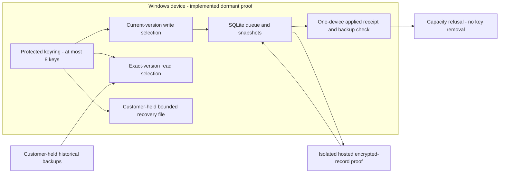
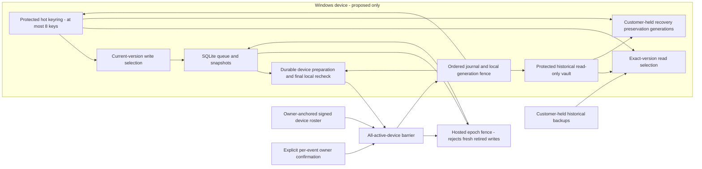

# Security Hardening Proposal: Preservation-first key retirement

## Decision

**Design review only. Not implementation-approved.** Source base: `097e8daa4459c03655dc5046372aefca0c138d97`, 2026-10-11.

We have founder approval for five preservation-first policies. We do not yet have approval for a new historical-key vault, an archival recovery format, destructive key removal, schema migration, production deployment or Sync activation. This proposal makes the mechanism and its remaining proof obligations reviewable; it does not convert policy consent into those permissions.

The word **retirement** needs a precise meaning. Under the approved policies, we may eventually stop using an old key for new writes and remove it from a bounded hot ring. We must preserve every key still needed by historical material. We cannot advertise cryptographic erasure or retraction of material already held by a compromised device.

## Executive Recommendation

The complete choice set is:

- **Option 1: Preserve the no-removal baseline** (`preserve-baseline`). Keep the existing eight-key ceiling and refuse additional rotation at capacity.
- **Option 2: Separate hot write authority from historical read preservation** (`hot-history-vault`). Develop a protected, read-only historical key store, an owner-anchored signed roster, a fenced all-active-device barrier and an ordered recovery journal.

I recommend advancing Option 2 **through specification and independent review**, while Option 1 remains the operational behavior. Option 2 addresses the capacity problem without pretending that historical recovery and total key erasure can both be guaranteed. What gives me pause is not the sparse representation; it is the new trust and recovery machinery we would need to make moving a key out of the hot ring safe. If that machinery cannot be proved, or its Windows resource limits are unacceptable, Option 1 should remain the final product behavior.

## Evidence

I inspected the source boundaries below. The most important observation is that today's applied receipt proves one device's current state and backup, whereas the proposed operation would change authority across every active device and historical generation. That is a different claim, not a stronger interpretation of the existing receipt.

| Evidence | Human-readable title and source | What it establishes |
| --- | --- | --- |
| review-claude | Supplied two-verdict independent AI review at 579cfed | Format approved with conditions; retirement implementation rejected pending schema, protocol, policy and concurrency work. The review's experiments were not reproduced in this phase. |
| source-ring | Bounded exact-version keyring: src-tauri/src/sync_v2_key_recovery.rs | Observed: MAX_KEYS is 8, versions are preserved, write_version is explicit, no removal operation exists, recovery/protected framing is bounded. |
| source-local | Local persistence and exact retries: migrations 0012/0014/0015; sync_v2_local_queue.rs; sync_v2_safe_apply.rs | Observed: local acknowledgements and applied receipts have workspace-only primary keys; pull history retains and compares original envelope bytes. |
| source-transfer | Single-key approved transfer: src-tauri/src/sync_v2_approved_device_transfer.rs | Observed: existing transfer carries one workspace key, not the historical ring, trusted roster or bootstrap floor. |
| source-hosted | Isolated encrypted-record backend: proofs/sync-v2-identity/supabase/migrations/20261010022507_c10_03g_encrypted_record_operations.sql | Observed: hosted record operations already exist. apply_record_batch uses request idempotency and a workspace lock, but no retirement barrier or epoch floor is implemented. |
| policy-founder | Founder policies: docs/engineering/C10-04D-KEY-ROTATION-RECOVERY.md at 097e8da | Observed: block on every active device, preserve historical recovery and backups, explicit per-event consent, owner-controlled signed membership. |
| policy-retention | ADR-019 privacy boundary and C10-03H hosted retention/deletion | Observed: hosted retention and deletion already have separate product limits; indefinite offline waiting must not silently extend them. |
| packet-existing | C10-04D-CLAUDE-REVIEW-INSTRUCTIONS.md | Observed: format conditions and activation gates remain distinct. |

The inferred structural condition is that we currently have a bounded, device-local key container and single-device evidence, but no authority object that joins membership, state, recovery preservation and concurrent mutation. We therefore cannot derive permission to prune a key from the existing receipt. This is a missing future capability, not a newly demonstrated deployed vulnerability.

The integrity registry and limitations are in [context](../context.md). Source references are repository-relative, pinned to the base commit. The supplied AI report is supplemental evidence, not a professional audit.

## Current Design And Failure Mode

We currently keep up to eight scoped keys in protected Windows storage. Writes select the active version; reads select the envelope's exact version. The sparse format lets us represent a future ring such as versions 1, 4 and 8 without renumbering, but representation alone does not establish that omitted versions are safe to omit.

A local applied receipt checks current snapshots against live rows and a pre-apply backup. Its workspace-only key is appropriate for this device's local apply protocol. Reusing that table as an all-device barrier would lose other devices' identities through replacement, exactly as the supplied review warned. We should not blindly alter that primary key either: existing callers assume a single local scope. A future multi-device barrier needs its own reviewed epoch/device schema, or a fully audited migration of every caller.

We also keep original envelopes in retry history. Re-encrypting those rows in place would change the bytes used to identify an exact retry. A superficially successful compaction could then turn a valid repeated operation into a mismatch. Retaining old-version read access avoids that hazard, but introduces a different lifetime: historical keys can outlive their eligibility for new writes.

The existing hosted proof contradicts the supplied report's broad statement that no hosted schema exists. The narrower conclusion remains correct: the hosted retirement floor, complete signed applied barrier and coordinated fence do not exist. Its apply_record_batch checks an already-applied request before acquiring the workspace lock. We must explicitly distinguish a harmless replay of a committed receipt from a new effect under a retired version, rather than moving checks until the old retry contract accidentally changes.

## Desired Invariants

We would require all of the following before any hot-ring pruning:

- Every ciphertext dependency remains decryptable with the same owner, workspace and immutable key version. Key numbers are never reused or renumbered.
- Historical material never gains write authority. A historical resolver cannot satisfy current write_version, even if it can decrypt an old envelope.
- The barrier contains a valid durable preparation from **every** device in a complete, independently anchored owner-approved roster at the exact epoch. Missing, stale, revoked-at-another-epoch, replayed or unverifiable evidence blocks it.
- Membership changes, restores, new conflicts and queued writes invalidate relevant local preparation. Server-side mutations serialize with the workspace epoch fence.
- A device prunes only after its own final dependency and preservation recheck under a local mutation fence. A global certificate alone cannot authorize local pruning of changed state.
- Retrying any transition is idempotent. A crash never leaves ciphertext requiring a key already discarded from every supported resolver.
- Old backups and old recovery files remain untouched and usable for the material they actually captured. They do not authenticate freshness or contain future keys.
- The founder approves each event's exact consequences. This document and policy approval are not such a confirmation.
- Unsupported clients fail closed for Sync without deleting credentials, project rows or ordinary files. Free local work, essential export and backup remain available.

We should test these as refusal properties, not rely on comments that instruct a future caller to be careful.

## Constraints And Non-Goals

We preserve the single-user, local-first Windows product. Multiple active computers are the same owner's devices, not collaborators, seats or organizations. Billing, licensing and telemetry receive no project content. This phase neither activates dormant Sync nor changes its consent boundary.

We assume a balanced engineering profile because no performance budgets were supplied. Same-user Windows compromise, already exfiltrated keys, denial of service by an offline device and authenticity without freshness remain residual risks. We do not promise provider-independent recovery of latest state after loss of every trusted device and anchor.

We reject silent archive migration, editing historical backups, raising MAX_KEYS as a substitute for safety, deleting resolved conflicts merely to clear a census, automatically excluding offline devices, and automatic retirement. We also reject simply re-encrypting all stored bytes: it breaks exact history semantics and cannot discover every customer-held recovery file.

## Before Architecture

The [before diagram](../diagrams/safe-key-retirement-before.mmd) shows implemented dormant proof boundaries, not an activated service. The receipt feeds a capacity refusal, not a removal capability.

The provider holds opaque records in the isolated proof, not decryption keys. The customer can hold backups and recovery files outside our discoverable state. Those two edges explain why a server census alone can never establish permission to destroy historical keys.

## Options

### Option 1: Preserve the no-removal baseline

We can keep the current behavior and document its lifetime rotation ceiling plainly. Nothing tries to manufacture all-device proof from a local receipt. Historical keys remain available in the original bounded ring, and a ninth resident version is refused without changing the ring.

This is a defensible choice if Sync remains dormant, if rotations are uncommon, or if we are not willing to introduce a new recovery protocol. It has the smallest trusted computing base and no new migration or provider dependency. It does not improve revocation-driven rotation availability once capacity is exhausted; we must tell users that limitation rather than allow a fallback that discards history.

Its resource effects are source-derived: the bounded ring and existing envelope operations remain unchanged. There are no candidate benchmarks to claim as improvements. We would validate that capacity refusal stays byte-identical and that local work remains available. Reversal is straightforward because we never migrate state, although this baseline is not a way to reverse a future already-committed epoch.

The [baseline after diagram](../diagrams/safe-key-retirement-preserve-baseline-after.mmd) deliberately matches the before view.

| Change | Before | After | Security consequence | Cost |
| --- | --- | --- | --- | --- |
| Retirement authority | None | None | No unsupported key destruction | Capacity can block indefinitely |
| History preservation | Original bytes and retained keys | Same | Exact retries and old decryption unchanged | Lifetime eight-key bound remains |
| Membership barrier | Not implemented | Not assumed | No false all-device approval | No compaction capability |

We should not call this a failed version of Option 2. It is a deliberate containment choice. The tradeoff is availability of future rotations, not loss of existing local records.

### Option 2: Separate hot write authority from historical read preservation

The strongest case for this option is that we can free **hot-ring capacity** while keeping historical recovery honest. We would distinguish the small ring used for current work from a scoped, protected historical read vault. An old version could leave the hot ring only after every active device has verified that the historical resolver and preservation generation can still supply it. We would retain all issued historical keys conservatively, because customer-held backups cannot be completely enumerated.

This is not secure deletion. A compromised device might already hold a key, and the customer's old recovery file intentionally still holds its captured keys. We would describe the operation as “retire from new writes and compact the active ring,” not “erase old keys.” That wording is a security property of the product promise.

#### Census and resolver boundary

The complete local ciphertext census must name twelve columns, including nullable values and resolved conflict rows:

| Table (sync_v2_ prefix) | Ciphertext column |
| --- | --- |
| record_snapshots | envelope |
| outbox | envelope |
| committed_bases | envelope (nullable) |
| pull_history | envelope |
| pull_parts | envelope |
| pull_batches | checkpoint |
| rotation_batches | checkpoint |
| record_conflicts | local_envelope |
| record_conflicts | remote_envelope |
| record_conflicts | baseline_envelope (nullable) |
| record_conflicts | pending_envelope (nullable) |
| record_conflicts | resolution_envelope (nullable) |

A census would validate structure, scope, exact version and integrity; count zero is not proof if a column was skipped. Digest-only receipt and anchor fields are not ciphertext. We would also account for current checkpoint floors, hosted history/bootstrap dependencies, recovery generations and ordinary backup dependencies. Unknown dependencies block destructive removal; they do not prevent retaining an old key in a historical resolver.

The historical resolver would expose read-only selection by owner/workspace/version. A separate current-write capability would select only the committed active version. We would never route writes through a generic “find any available key” fallback. Existing strict write_version checks stay in place through migration.

#### Protected storage and historical recovery

The proposed vault needs an authenticated version inventory and bounded access, not an ever-growing Secret Vec loaded for every record. We would store scoped immutable historical entries, validate the catalog against locally trusted state, load only required entries, zeroize temporary values and refuse catalog substitution or missing material. Windows Credential Manager quotas, enumeration behavior, storage failure and atomicity need measured proof before we choose an encoding or entry budget.

Current SDREC002 files hold at most eight keys. We cannot silently stretch that format into an unbounded archive, or suggest that today's single-key device transfer already carries the vault. A separately reviewed historical preservation format and full-history transfer protocol are prerequisites. Their future wire specification must define domain separation, authentication, bounded chunk ordering, scope, generation binding, truncation/duplication rejection and recovery tests using mature existing primitives. This proposal intentionally assigns no new magic bytes, cryptographic construction or published minimum client version before those reviews.

Old SDREC001/002 files remain untouched, with their original captured keys and scope. A new preservation generation must cover all historical entries required after total device loss, not only the latest hot ring. Before pruning, we would require a freshly verified customer-held preservation copy under a new filename. “Export succeeded” alone is insufficient; import into an isolated fictional recovery drill must demonstrate the dependencies are usable. A customer who declines that step keeps the baseline behavior.

#### Complete roster and signed preparation

We need a complete signed membership history anchored independently of the provider's mutable device list. Existing device Ed25519 identities give us signing material, but not automatically an owner authorization root or a complete chain. The future root-binding and recovery procedure must be specified separately: owner/workspace binding, initial trust, device authorization, revocation, monotonically ordered roster epochs and durable pinning on each trusted device.

A provider-truncated roster cannot authorize omission of an active device. A new enrollment or explicit owner-approved revocation starts a new epoch and invalidates collected preparation. Offline age never removes a device. Revocation is a separate consent event, not a button that silently clears a stalled barrier; unsynced local work remains intact.

Each device's signed preparation would bind, through a reviewed canonical encoding, the purpose, owner/workspace, device identity, roster epoch and anchored roster digest, retirement event nonce, checkpoint/cursor digest, proposed retired and retained versions, write floor, required client capabilities, preservation manifest digest and local fence generation. Fixed scope and purpose binding prevent a staging acknowledgement or snapshot receipt from being replayed as retirement permission. All active device signatures must verify against the anchored roster, with exactly one valid preparation per device for that event.

The aggregation storage must be keyed by workspace, retirement event/epoch and device; its exact SQL migration is future work. We would either introduce a separate barrier store or migrate existing tables only after auditing every single-device caller. Merely changing the existing primary key is not an accepted fix.

A verified barrier would become a private typed capability. It must not be deserializable from untrusted JSON as “verified,” constructible from an applied receipt, or reusable after an epoch/generation change. The mutation boundary still rechecks durable state transactionally; a Rust type alone cannot fence another process.

#### Quiesce, fence and multi-store journal

We cannot make Windows protected storage, SQLite, a customer-held file and a hosted transaction globally atomic. We can make their ordering recoverable and ensure that every intermediate state still preserves decryption. PostgreSQL row locks last for their transaction; they do not extend to the desktop. The backend therefore needs a durable workspace epoch fence in addition to a consistent lock order. See the official [PostgreSQL locking guide](https://www.postgresql.org/docs/current/explicit-locking.html).

Proposed state progression is Draft -> LocallyPrepared -> WaitingForAllDevices -> BarrierVerified -> CommitIntent -> HostedFloorCommitted -> LocallyFinalized -> Completed. Blocked and Aborted are explicit states; an abort after hosted commit cannot lower the floor. Each transition has an event ID, authenticated input digest, expected previous durable state and idempotent result. Timeouts may end waiting but never imply acknowledgement or authorize pruning.

Preparation first persists and read-verifies historical preservation, records the dependency census and enters a local generation fence. Ordinary local editing stays available: if it mutates relevant state, preparation is invalidated locally and hot-ring pruning is refused. A device that goes offline after preparation can keep editing; its previously signed message must not be treated as proof that its local state is still unchanged at pruning time. That device retains its keys and must revalidate on return. The backend might already advance a floor based on the earlier barrier, so the final protocol must also prove that such unsynced work remains rebaseable with preserved keys and is never silently dropped. **That offline-after-preparation proof is unresolved and blocks pruning implementation.** We should not paper over it with a signature expiry.

On the hosted side, new record effects, enrollment, revocation, restores/bootstrap and retirement commits must serialize under one workspace epoch boundary with a consistent lock order. Retired-version fresh writes fail; exact already-committed retries return their original result without new effects. New-schema/RLS grants and authorization tests must be explicit, not inferred from automatic exposure defaults. Official [Supabase RLS guidance](https://supabase.com/docs/guides/database/postgres/row-level-security) supports that responsibility but does not prove the retirement protocol.

Before any individual device prunes its hot ring, it rechecks the committed certificate, roster epoch, local generation, every ciphertext dependency, historical vault, verified preservation copy and current-write version while holding its local mutation fence. If any value changed, it retains keys and returns Blocked. We would persist cold material before hosted floor commit, and commit that floor before publishing local write authority or pruning. Crash recovery resumes the exact event or blocks with preserved material; it never guesses that another store succeeded.

An unknown outcome after a hosted request requires querying the exact event and verifying its certificate against trusted anchors. Provider absence or contradictory results are not evidence of success. After the hosted floor advances, rollback means disabling Sync writes and preserving all keys and local work until recovery, not reverting to an old executable or accepting lower-version writes.

#### Architecture and operational cost

The [candidate after diagram](../diagrams/safe-key-retirement-hot-history-vault-after.mmd) separates current-write authority from historical-read ability. Every node newly added by this option is proposed, not implemented.

| Change | Before | After | Security consequence | Cost |
| --- | --- | --- | --- | --- |
| Key lifetime | One bounded ring | Hot ring plus preserved read-only history | Hot capacity can be reclaimed without promising erasure | More protected entries and recovery complexity |
| Authority | One-device receipt | Complete signed roster and epoch/event barrier | Missing devices and substituted receipts refuse | Durable signatures, schema and trust-root protocol |
| Concurrency | Local staging and hosted per-operation locks | Local generation fence plus hosted epoch fence | Rechecks state at the actual mutation boundary | Waiting, lock discipline, recovery state machine |
| History | Exact original bytes | Exact bytes plus historical resolver | Retries preserved; no in-place rewrite | Historical read I/O and dependency accounting |
| Recovery | Eight-key file; one-key transfer | Reviewed full-history preservation and transfer | Total-loss and enrollment dependencies explicit | New protocol review and fictional recovery drills |

Keeping historical keys is a storage cost that grows with rotations; it is not free or necessarily unbounded in practice. We would set a tested storage budget and refuse further compaction before exceeding it. That preserves safety but means Option 2 still cannot promise unlimited rotations. Memory can stay bounded through selective reads, although retention catalogs and import validation need careful limits.

The latency cost is concentrated in preparation and historical reads, rather than necessarily every current write. The availability cost is more significant: one unavailable active device intentionally stalls the event. Diagnostics should distinguish that expected wait from corrupt preservation, unsupported client or storage failure, without exposing records, paths, keys or database contents.

We can introduce the components as read-only proofs and compare decisions against the baseline before allowing mutations. Reversal before an epoch commit disables the candidate and leaves the original ring. Reversal afterward preserves the vault and a compatible reader; old-client downgrade cannot be our recovery plan. This makes Option 2 a foundational change, not a small patch to rotate().

## Comparison

The table records expectations, not measurements. Each cell gives direction/confidence/basis; validation appears in the next column. “Unknown” is a real result where the proposal lacks an implementation.

| Dimension | Option 1 | Option 2 | Validation / decision basis |
| --- | --- | --- | --- |
| Security | neutral / high / source-derived: no removal capability | improves / medium / hypothetical: epoch-bound authority, but new vault/root trust | Adversarial barrier, resolver and corruption cases must all refuse before mutation |
| Performance | neutral / high / source-derived: unchanged paths | regresses / medium / hypothetical: census, signatures, storage reads and fences | Compare fictional 1/8/100/1000 historical-version workloads; current-write p95, historical-read p95, preparation duration |
| Memory/resources | neutral / high / source-derived: bounded ring | regresses / medium / hypothetical: growing storage/catalog; bounded lazy key reads intended | Peak RSS, protected entry count/size, bounded parser allocations; establish budgets before implementation approval |
| Reliability | neutral / high / source-derived: deterministic capacity refusal | unknown / low / hypothetical: crash-recoverable ordering proposed, not demonstrated | Kill/restart at every cross-store transition; verify all ciphertext and backup/recovery dependencies |
| Operability | neutral / high / source-derived: existing refusal | regresses / high / hypothetical: stale waits, journals and version support | Content-free reason codes and recovery runbook; no hidden auto-revocation |
| Migration | neutral / high / source-derived: no format/schema change | regresses / high / source-derived: current file/transfer/local schema insufficient | Mixed clients, full-history transfer, restored databases, RLS migration and downgrade cases |
| Developer ergonomics | neutral / high / source-derived: small explicit API | improves / medium / hypothetical: typed capabilities; more state transitions | Compile-fail authority tests plus model-based transition coverage |
| Rollback | neutral / high / source-derived: no new state | regresses / high / hypothetical: preserve compatible readers after floor commit | Disable candidate writes without removing historical keys or lowering authenticated floors |

The advantage of Option 2 is not a benchmark score. It is making the lifetime distinction explicit enough to review and enforce. We would choose Option 1 if the storage/recovery overhead, offline-device behavior or trust-root complexity fails its acceptance gates.

## Recommendation

I recommend Option 2 as the next **design/proof direction**, with Option 1 retained until the gates below pass. We should first prove historical access and the offline-after-preparation case before investing in a mutation API. That ordering lets a failed proof end the project safely without a half-installed retirement capability.

The founder's five choices are already recorded; we should not ask for them again. We will need a separate choice of mechanism after independent review, especially because a new preservation format and relocation of keys were not part of that consent. We must not merge this proposal into a claim that Sync is ready.

## Evidence Coverage And Residual Risk

| Evidence | Option 1 effect | Option 2 effect if implemented and validated | Tactical protection still required |
| --- | --- | --- | --- |
| review-claude — independent retirement prerequisites | mitigates: no dangerous operation | addresses design concerns conditionally; implementation proof unknown | All original refusal/activation gates remain |
| source-ring — bounded keyring and formats | unaffected: ceiling retained | mitigates hot capacity limit; total erasure not addressed | Exact versions, strict write_version, legacy-read-only and mismatch diagnostics |
| source-local — single-device receipts and exact bytes | unaffected | addresses through separate epoch/device evidence and preserved bytes | Existing single-device receipt and replay checks stay intact |
| source-transfer — one-key transfer | unaffected | unknown until full-history transfer is specified and tested | Do not claim current transfer covers history |
| source-hosted — existing write proof without retirement fence | unaffected | unknown until epoch serialization and fresh-write floor tests pass | Idempotency, owner/device authorization and RLS remain necessary |
| policy-founder — five conservative choices | addresses by never pruning | addresses only if preservation and every-device checks hold | No automatic event consent or stale-device exclusion |
| policy-retention — hosted retention/deletion | unaffected | unknown: integration conflict must be resolved | Never silently extend retention or postpone explicit deletion |
| packet-existing — format/activation gates | unaffected | unaffected: gates cannot be waived by this proposal | Independent review and founder activation decisions remain separate |

The current format conditions are not reopened as unfixed claims: the newer-format diagnostic, explicit twelve-column list and legacy-writer test-only boundary were addressed in the intervening source work. They remain regression obligations.

Historical recovery codes alone do not contain project snapshots or establish latest-state freshness. Retaining a key does not force the provider to retain data forever. Total loss of trusted roster anchors, recovery artifacts or all compatible readers remains a separate recovery problem. Same-user compromise and previously copied keys are unaffected. We cannot call these solved by moving keys into another Windows credential.

## Migration And Rollout

We would begin with inert specifications and fictional fixtures on the review branch. No production project, user record, credential or ordinary backup is a test fixture. Each vertical slice must separately satisfy code review, adversarial tests and documentation before the next.

The proposed migration preserves single-device receipt semantics and adds explicit multi-device epoch evidence only when its callers are ready. No source change is authorized by this packet. Capability/version negotiation must name a real published supporting build before activation; the current 1.4.4 installer must not be described as supporting this future design merely because these docs are on a review branch.

We would test import of old files without rewriting them; new preservation copies always use new user-approved paths. Before hosted floor commit, cancellation leaves the old ring usable. After commit, rollback retains the newer reader, vault, journal and local records while stopping Sync writes. No forced application downgrade, database rollback or secret removal is part of rollback.

A retention conflict remains explicit: ADR-019's tombstone/ack retention policy, including its operational cap, cannot silently become indefinite because a device is offline. The all-device barrier may wait forever while hosted retention continues under its own rules. If those rules remove history needed for safe bootstrap, retirement stays blocked. Any new bootstrap/archive or retention adjustment requires its own reviewed policy decision; this design does not extend retention or weaken deletion promises.

## Validation Plan

These are **planned tests, not tests executed in this phase**.

| Scenario | Required result |
| --- | --- |
| Missing/offline active device; provider omits it | No barrier and no pruning |
| Enrollment or revocation after preparation | Epoch mismatch invalidates barrier; all keys retained |
| Restore/new conflict/local edit after preparation | Final local generation/dependency check blocks pruning |
| Device edits offline after signing; backend commits floor | Unsynced work remains local and recoverable; stale preparation never permits local pruning; rebase/transfer protocol proved |
| Snapshot receipt or staging ack supplied as authority | Cannot construct verified retirement capability |
| Replay/cross-workspace/cross-owner/altered candidate list | Signature/scope/event mismatch; no side effects |
| Each of twelve columns populated, including nullable and resolved conflicts | Exact-version read succeeds before and after candidate compaction |
| Catalog corruption, missing entry, wrong scope/version | Refuse, retain original hot ring |
| Old recovery generation; old historical backup; total-loss newest preservation restore | Captured material remains usable; no invented freshness; full required key inventory restored |
| Full-history device enrollment with unavailable archive | Refuse enrollment completion for required history, never silently omit keys |
| Identical original committed batch retry after epoch advance | Original result without effects; new retired-version request refused |
| Crash before/after each store write, lost response, concurrent devices | Resume exact event or block; no loss of decryptability; no lowered floor |
| Older client/newer storage, lease timeout, explicit cancellation | Compatible failure, no deletion and no automatic success |
| Explicit cloud deletion during preparation | Retirement cannot bypass deletion or recreate deleted cloud state |

We would benchmark baseline and candidate using fictional inventories of 1, 8, 100 and 1000 historical versions, valid small/large queues and fragmented conflict histories. Metrics are current-write and historical-read latency, census duration, peak RSS, credential storage/entry count and recovery-import duration. No thresholds are measured or approved yet. Before implementing the selected mechanism we must establish Windows storage limits and product acceptance budgets; safe budget exhaustion must postpone compaction, not drop history.

Validation in this design phase covers document structure, evidence identity, links, JSON references and diagram consistency only. It does not count as concurrency, cryptographic or Windows behavioral proof.

## Implementation Work Packages

These are gated future slices, not permission to code or deploy:

| Package | Deliverable and acceptance gate |
| --- | --- |
| D1 — census and semantics | Read-only twelve-column inventory, exact-retry fixtures and explicit hot-versus-historical dependency model; no omitted nullable/resolved path |
| D2 — membership trust | Canonical signed roster/root binding and recovery specification; omission/replay/rollback tests; separate epoch/device schema plan without breaking existing local receipts |
| D3 — historical preservation | Scoped read-only vault, storage budgets, full-history recovery/transfer specification and independent cryptographic review; old files/backups untouched |
| D4 — epoch/fence protocol | Hosted authorization, consistent locks, floor/bootstrap semantics, offline-after-preparation proof and original exact-retry behavior |
| D5 — ordered recovery | Durable event journal, verified capability construction, model/fault-injection coverage across every store boundary; no hot pruning yet |
| D6 — mutation and consent | Only after independent approval of D1-D5 and founder mechanism selection: separately reviewed pruning slice with final local recheck and explicit per-event confirmation |
| D7 — eventual activation | Separate supporting release/version negotiation, fictional end-to-end recovery, consent/deletion/retention verification and explicit founder activation approval |

The key-removal function must not exist in production before D6's gate. A capacity refusal is an acceptable terminal result for any failed gate. We would continue documenting the eight-key limitation rather than move these obligations into a future release silently.

## Open Questions

- Can a canonical owner-root trust anchor be introduced and recovered without allowing a provider to authorize a truncated roster? Existing SDREC002 does not supply that complete membership anchor.
- Can we prove preservation of offline edits when a floor commits after an earlier preparation, or must the protocol impose a stronger durable freeze with clearly disclosed local behavior? This is not resolved by timeouts.
- Which historical preservation format and Credential Manager entry budget survive Windows and total-loss drills? No construction or budget is selected here.
- How do existing tombstone retention limits and explicit cloud deletion constrain bootstrap/archive availability? Any product policy change needs separate consent.
- Which published build will be the minimum compatible reader, and which measured latency/storage budgets will gate it?

We can close these questions through narrow proofs and review. Until then the safe, implemented answer remains: preserve keys, refuse at capacity, and keep ordinary local work available.
